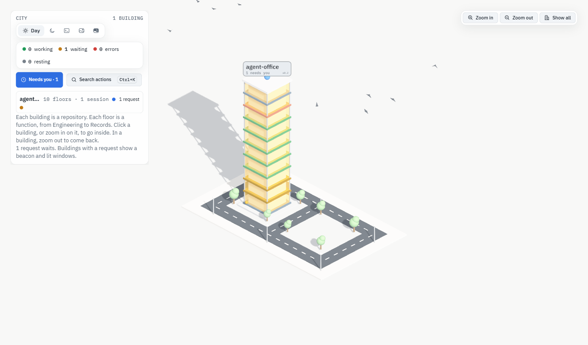
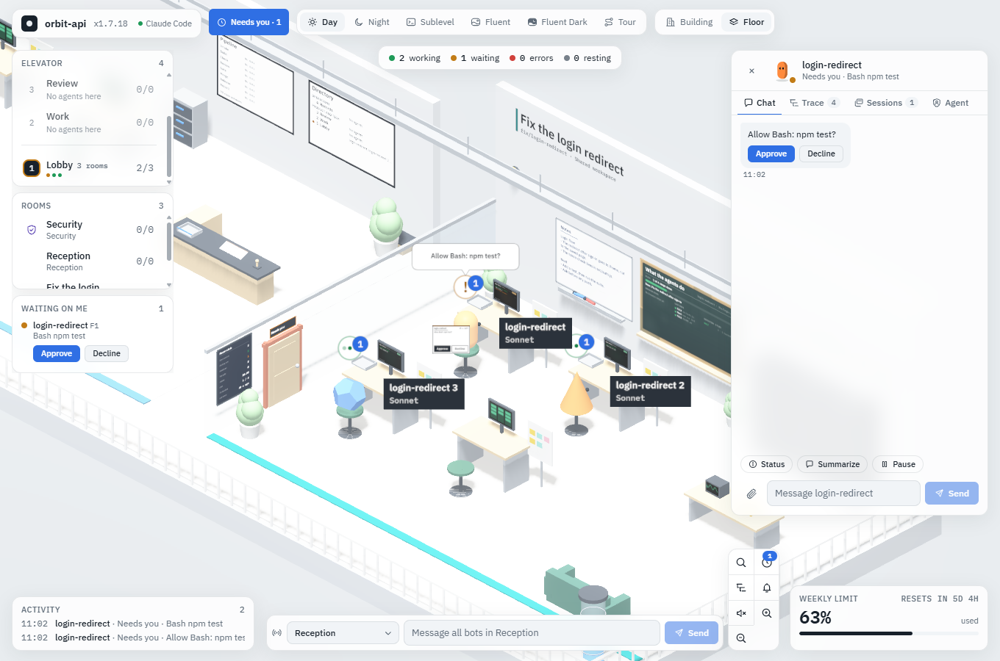
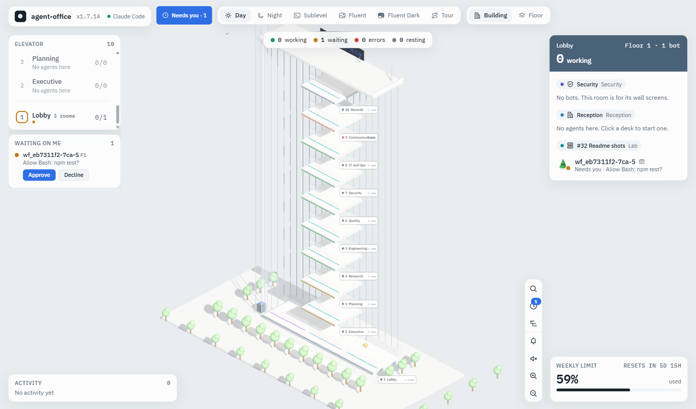

# Agent Office for Claude Code x0.2

[](https://github.com/parthalon025/agent-office/actions/workflows/ci.yml)

Agent Office is a 3D office that shows your Claude Code sessions as bots at desks. You open a session, talk to it in a chat, approve its steps, read what it changed, and close it, all from one browser tab. No terminal is needed. It also runs local models, ACP agents, OpenClaw, Agent Framework teams and cloud agents, and one Security room sets what each of them may do. It runs on your PC only, with no dependencies. The interface is built on the Agent Office design system (x1.7.19), which lives in this folder (see [DS-README.md](docs/design-system/DS-README.md)).

## Screenshots



The city shows every repository as a building. A beacon and lit windows mark a building with a request that waits for you, and the City panel lists each building with its sessions.



Click a bot to open the chat of its agent. The held request shows its command with Approve and Decline, and the same line shows in a speech bubble at the desk.



Needs you lists every held request of every building. Approve or decline it from the left column. More screenshots are in [Using the office](docs/using-the-office.md#screenshots).

## Requirements

- Windows 11. Opening and closing sessions is written for Windows.
- Node.js 24.11 or newer.
- Claude Code 2.1.295 or newer, already signed in. The office uses your existing login. It was tested on 2.1.317.
- Git for worktrees and the Changes view. The GitHub CLI (`gh`) for pull requests.

There is nothing to install. The server has no dependencies, and the page needs no internet access: React and the fonts come with the office (`public/vendor`, with their versions and licenses in `public/vendor/README.md`). One optional part downloads software: if you click Install Paperclip in Attach sessions, the office installs a pinned Paperclip with npm into its own folder ([Paperclip HQ](docs/paperclip.md#run-paperclip-from-the-office)).

## Start it

```
cd E:\agent-office
npm start
```

The office opens in your browser with a launch link (`http://127.0.0.1:4317/#n=...`). The server also prints the link. The link works once, for 5 minutes. After that, a reload or a bookmark of http://127.0.0.1:4317 keeps working until the office or the browser stops. For a new link, run `npm start` again: a second copy changes nothing and opens a new link for the office that runs. Ctrl+K finds every action.

## The five core jobs

1. **Start an agent.** Click an open desk on a floor twice, or choose **Open session** at the Reception or in Ctrl+K. Pick a folder, then start it. The agent gets a worktree of its own by default, so your main branch stays clean. Click the bot to open its chat.
2. **Answer an approval.** A bot that needs you shows an amber badge. **Needs you** in the top bar goes to the oldest request in one tap, in any building. Read the request, then click Approve or Decline. A session in the office waits 15 minutes for you. A terminal session waits 60 seconds.
3. **Read the change.** Choose **Changes of** the bot in Ctrl+K. The diff shows on the blackboard of the room. The same button is in **Past** for a closed session.
4. **Merge or discard.** On the Changes view, **Create pull request** pushes the branch and opens a pull request after you confirm. To discard the work, close the session and use **Remove worktree**, which also asks you first. The office never pushes, merges or removes anything by itself.
5. **Find a past session.** Open **Past** at the Reception or in Ctrl+K. **Reopen** brings a session back, and **Forget** removes it with its history. **Search actions** (Ctrl+K) searches every past session.

All the jobs, with every control, are in [Using the office](docs/using-the-office.md#core-jobs).

## Documentation

| Document | What is in it |
| --- | --- |
| [Using the office](docs/using-the-office.md) | Every feature of the page, the full core jobs, terminal sessions, limits and more screenshots. |
| [Agent kinds](docs/agents.md) | Claude Code, local models, ACP agents, OpenClaw, Agent Framework, cloud agents and Copilot CLI: setup, readiness and supervision. |
| [Security](docs/security.md) | The Security room, the two tokens, what the office keeps on disk, and links to the [security review](docs/security-review.md) and the decision records in [docs/adr](docs/adr). |
| [Remote access](docs/remote-access.md) | Open the office from a phone or laptop through Cloudflare Tunnel and Access. |
| [Paperclip HQ](docs/paperclip.md) | Enter a Paperclip company as a building (its org chart as floors, its employees at desks), hold its Claude Code calls, and let the office install and run Paperclip for you. |
| [Manager board](docs/manager.md) | Goals, plans, steps and the handoff to Paperclip. |
| [Customization](docs/customization.md) | Personas, teams, wall screens, export, rituals and Focus mode. |
| [Configuration](docs/configuration.md) | Every environment variable. |
| [Troubleshooting](docs/troubleshooting.md) | Problems and fixes, by kind of session. |
| [Development](docs/development.md) | Commands, tests, the core-jobs gate, branch ports, how it works and the file map. |
| [DS-README.md](docs/design-system/DS-README.md) | The design system: rules, recipes, reference and concepts. |

## Contributing and license

Read [CONTRIBUTING.md](CONTRIBUTING.md) before you open a pull request. To report a security problem in private, follow [SECURITY.md](SECURITY.md). The office is licensed under the [MIT license](LICENSE).
