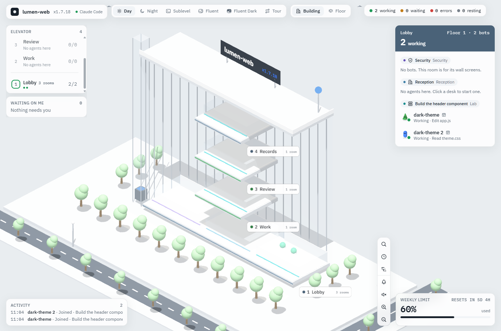
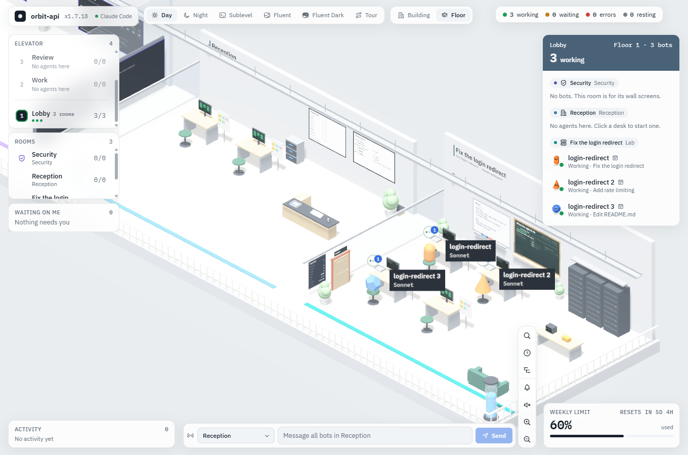
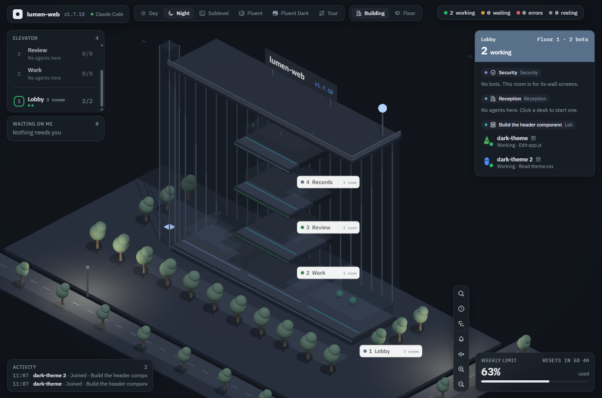
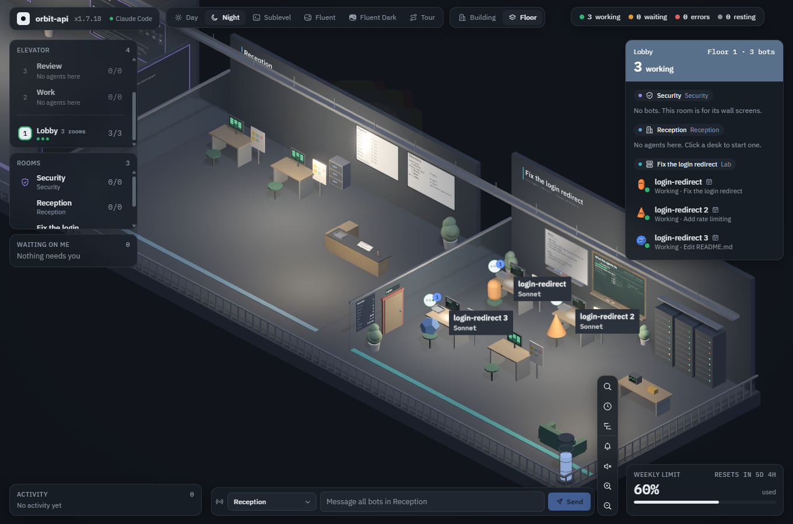
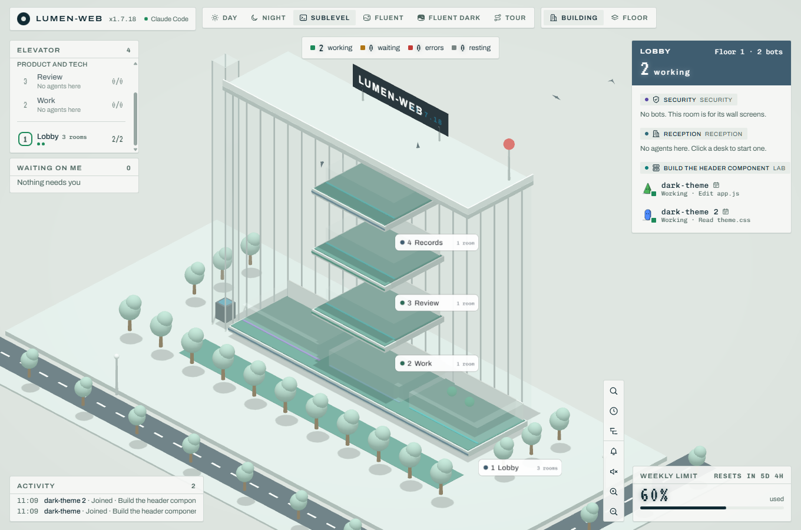
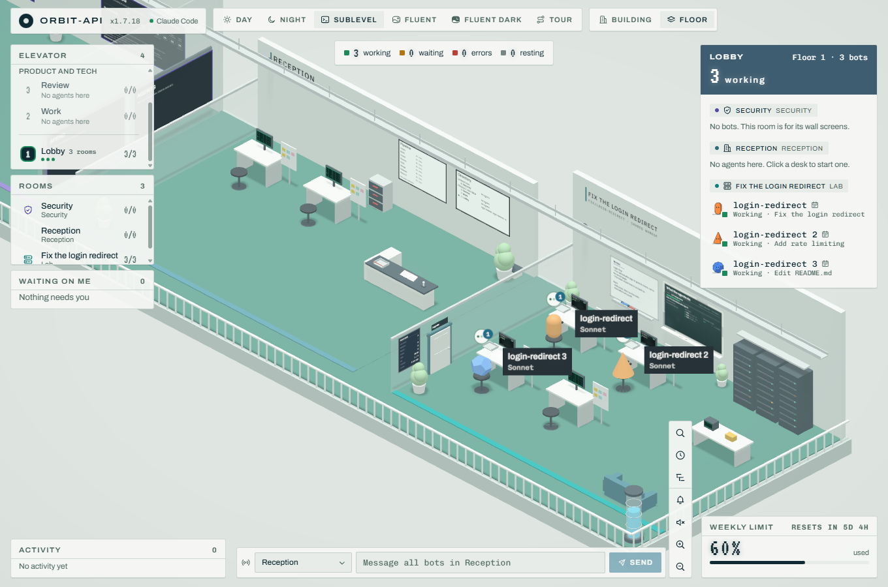
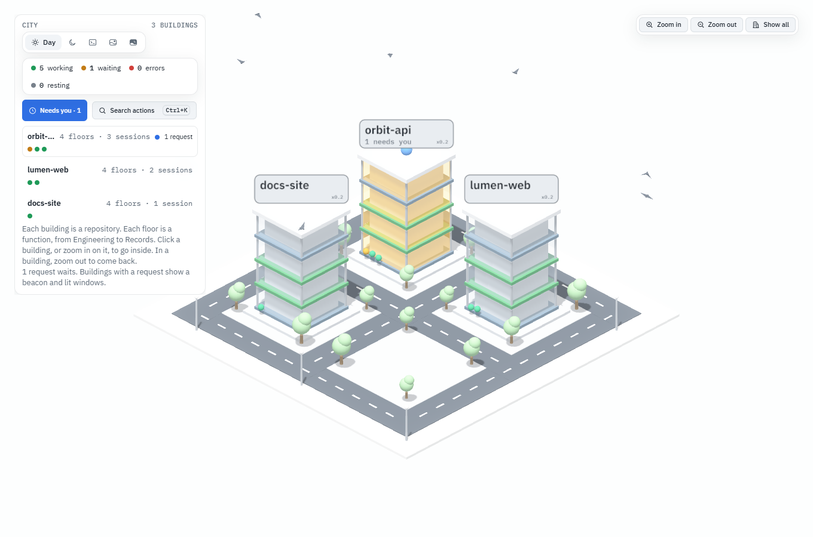
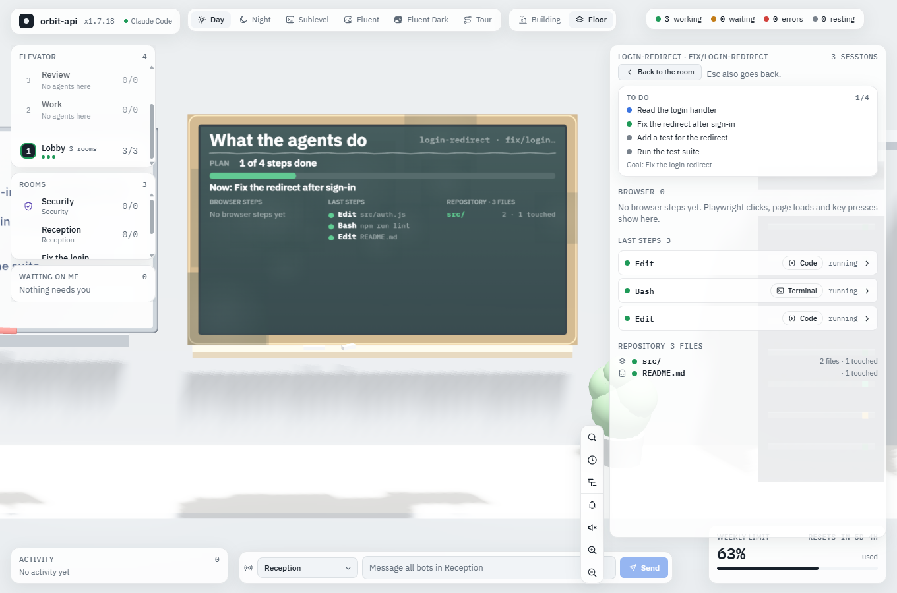
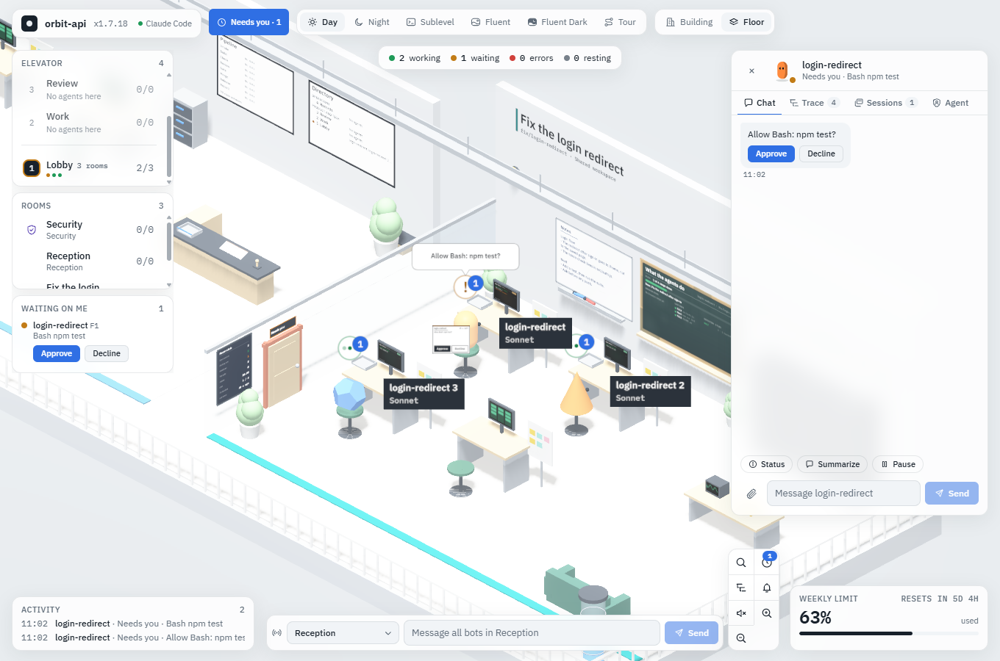
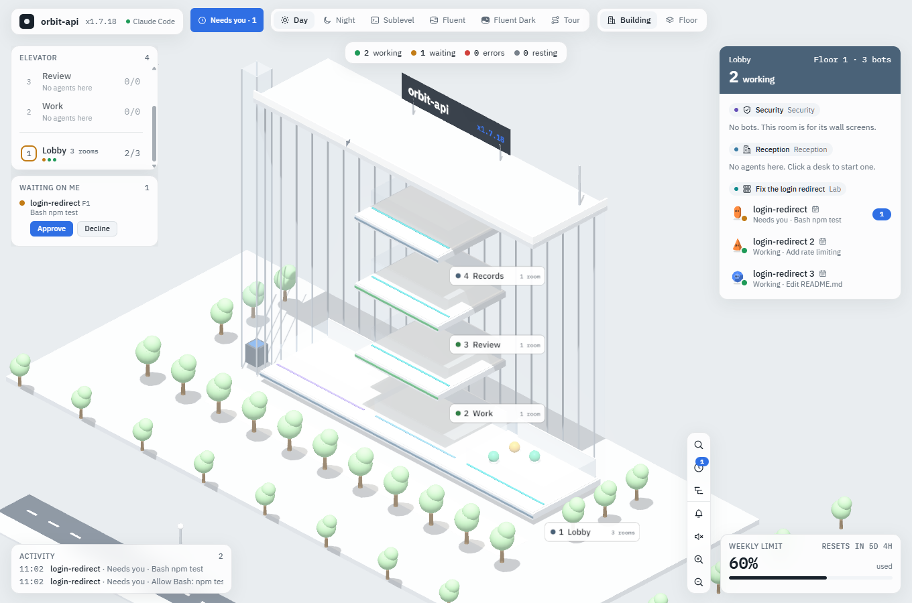

# Using the office

Everything the page does, in one place. The short start is in the [README](../README.md). Agent kinds are in [Agent kinds](agents.md), permissions in [Security](security.md), and settings in [Configuration](configuration.md).

## Screenshots

The same office in Day, Night and Sublevel. The Fluent themes look alike with other tokens. Each theme has one image of a building and one of a room.

**Day**



The building view in Day. The elevator panel on the left lists the floors, the card on the right lists the rooms and bots of the Lobby floor, and Waiting on me is empty.



The floor view in Day, zoomed to a lab room. Each desk has a monitor, a bot and a speech badge. The blackboard and the notes board hang on the back wall.

**Night**



The same building in Night. Each floor is a slab with a tag that names it. Choose Building or Floor at the top to switch the view.



The room in Night. The desk monitors are lit, and the light pools on the floor.

**Sublevel**



The Sublevel theme uses a monospace face, capital letters for labels and a green accent. The floor list and the room card keep their places.



The same room in Sublevel. The room floor is green, and the Weekly limit shows at the bottom right.

**The city, the boards, a desk and a held request**



The city shows every repository as a building. A beacon and lit windows mark a building with a request, and the panel on the left counts sessions by state and lists each building.



The room blackboard shows what the agents do: the plan, the browser steps, the last steps and the top folders of the repository. Click a board once to look at it, as here. The panel on the right lists the same plan and steps.



Click a bot to open the chat of its agent. A held request shows its command with Approve and Decline, and a speech bubble at the desk says the same.



The Needs you button in the top bar and the Waiting on me card list every held request of every building. Approve or decline it from the left column.

## What it does

- **City.** Every repository stands as a building in one city: a floor per branch, a pip per session, a beacon when a session needs you. Scroll to zoom toward the mouse, right-drag or Shift-drag to move sideways, drag to turn. Click a building, or zoom in on it, to fly in. Inside, zoom out past the widest view to go from floor to building to city: one scroll gesture leaves one level, with a short pause after each, and the building level needs three pushes. The City does not zoom out past Show all. The City panel has the theme switch (Day, Night, Sublevel, Fluent and Fluent Dark; in a narrow panel it shows icons and the name of the current theme), the number of sessions by state across all buildings, a Search actions button (Ctrl+K works too), and a status dot for each session in each building row. New buildings rise, removed ones sink, floors grow and shrink, sessions pop in and out. Streets with lane marks, trees and street lights run between the lots (the lights glow in Night and Fluent Dark), and birds circle over the city. The building view of the office gets the same street, trees and birds around its lot; the floor view, which is inside, gets none.
- **Moving around a floor.** Inside a building, the arrow keys move the view one room at a time along the floor, and Up and Down move it back and forth (they work while nothing has focus: not in a field, a list, a dialog or the Ctrl+K palette, and not while a screen is in focus). Drag with the middle button (the wheel) or the right button to move the view sideways. Drag with the left button to turn it: the view turns around the middle of the room that is nearest the centre of the scene. The wheel zooms. With reduced motion a key moves the view at once.
- **Reduced motion.** With the system setting on, City flies and zoom steps cut at once, the camera goes to a room screen and back at once, buildings do not lift, a door that an agent uses stays shut and shows a still ring, and terminal cursors do not blink.
- **Look, then open.** The screens of a room (the board, the notes board and the stats display) take two clicks. A desk monitor takes one: it flies you to it and the chat opens on it (see the Desk monitors item). The first click flies the camera up to the screen, so it fills most of the free part of the view and you can read it; a bot or a desk in front of it is cut away. Click it again to open it: the board overview, the notes editor, the room stats or the session terminal. The bar under the screen has the same two steps: Back to the room, and the screen's own action. Click another screen to look at that one. Esc, Back or a click on empty scene flies back. The door opens the agents dialog with one click.
- **Room boards.** The board on the back wall of each room is a live screen: the session's to-do list, the browser steps (Playwright page loads, clicks, key presses), the last tool calls, and the top folders of the repository with the ones the agents touched. Open it and a side panel shows the same in full, with the board framed beside it. The camera stays yours: turn, zoom and move, then press Esc or Back.
- **Notes board.** Next to it hangs a notes board for your own reminders. Open it and you write on the board itself. The notes editor takes focus when the camera arrives, and its text is never smaller than 16 px. Notes save as you type and stay per room (in `state.json`). Rooms have taller walls so the room name sits above the cable tray.
- **Desk monitors.** Each monitor shows its session as a terminal. Click it and the camera flies to it; when it lands, the monitor is a real screen: the chat with that agent, its whole terminal and the timeline of its tool calls, in tabs. You can type, scroll, select and copy there. The open requests of the session show first, under the head of the screen, with Approve and Decline. On a small screen (a phone) an open request takes the whole screen under the head until you answer it, so Approve and Decline are always on the screen. For a session in the office, the message box takes focus; a terminal session says to type in its own window or use the Chat tab.
- **Changes on the wall.** Changes of a session (Ctrl+K) fly to its room and show the diff on the room's blackboard, with Refresh, Create pull request and Remove worktree. Pull request and removal still ask in a dialog. A session with no room on screen (a past session, another building) shows its changes in a dialog.
- **Needs you on every screen.** While a screen is in focus, its frame shows how many requests wait, in every building. One click goes to the desk of the oldest one.
- **Needs you.** While a request waits in any building, the top bar of the office (and the City panel) shows **Needs you** with the number of requests in every building, at every window width and on a touch screen. One tap goes to the oldest request: its building, its floor and the desk screen of its bot (the chat), where Approve and Decline are. **Needs you** at the Reception or in Ctrl+K lists every request, oldest first, with Approve, Decline and Go to (a question has Yes and No). With browser alerts on, a request or an error in any building alerts you while the page is hidden. The tab title shows the total, also in the city.
- **Keyboard path.** Ctrl+K opens the room tools (board, notes, stats, agents) of the floor on screen, both steps at once. The hint that shows when the pointer is over a screen, a display or the door names the next click and carries a Ctrl+K key chip. In the building view, pick the floor first with its Floor action in Ctrl+K. For each session, Ctrl+K opens its terminal and its changes, Stop turn, and Go to. Esc closes only the top layer: a dialog or the palette first, then the board.
- **Toasts.** A toast with an action, and every error, stays until you close it. The others close after 8 seconds, and wait while the pointer or the focus is on them.
- **Since you left.** When you open a building, the card counts what happened there since you last saw it. A building you come back to shows only the news. Requests that were open before do not show a toast again; they stay in Needs you and in Decisions.
- **Repos as buildings, functions as floors.** A git repository is a building. Its floors are company functions (Engineering, Quality, Security, ...), set by the kind of building (its archetype): Software product, Knowledge base, Operations Hub or General. The office proposes the kind from the file names at the repository root and one level down (a mixed or unclear folder gets General), and the memo on the reception desk asks you to confirm it once. Every building has the **Lobby** on the ground floor (Reception, directory board, open desks, the Security room) and **Records** on top. At the Reception you switch the kind, rename, add, hide and reorder floors. Pick another building in the city or with Ctrl+K; the tab title counts the requests of every building. Folders outside git share the "Other folders" building.
- **Floors and rooms.** The Floors dialog creates a floor (a new branch with its first worktree), adds a room (one more worktree on a branch, also on a branch that has one), removes a room and deletes a floor (its worktrees and the branch). You can name a room when you add it: the name is the worktree folder name (letters, digits, dots and dashes; Windows reserved names are refused). **Clean up unused floors** lists the floors that are merged into the main branch, have clean rooms, no session and are over an hour old (never the default branch). Press Keep this floor to leave one out, then confirm to delete the rest. It never forces. Removing a room also deletes the files git ignores in it, such as a local `.env`; the confirm dialogs say so. Git refusals (uncommitted changes, commits that are not merged) show with a button to go ahead anyway. The main folder and a room with an open session cannot be removed. A floor cannot be deleted while an agent room sits on it: remove the agent rooms first. The branch of a removed agent room stays in git and is not offered as a floor.
- **Extensions.** The Extensions button (More > Actions for the selected bot, or Ctrl+K) lists the session's connectors (MCP servers) and plugins. Turn a connector off or on for this session, reconnect it, add one (a URL or a command) or remove one. Turn a plugin off or on for this folder, install or remove one. Saved changes go to the local or project scope of the folder, never to your user settings.
- **Sessions as bots, seated by role.** An agent sits on the floor of its role: the role the Manager gave it, else the floor of the open desk you clicked to start it, else its agent type (a `reviewer` sits on Quality), else the open desks of the Lobby. Each agent gets its own room: Open session makes a new worktree (branch `agent/<name>-<id>`, folder `<repo>.worktrees/<name>` next to the repository) unless you tick **Use this folder**. A room is named from its task (the Manager goal, a linked issue such as `#57`, the first prompt, then the branch); the main checkout, which ad-hoc sessions share, is named by its branch only. Its sign shows the branch in small print and **Shared workspace** (two or more agents, or the main checkout) or **Private** (an agent room with one agent). A room is on the floors where its agents sit now: when no agent of the room sits on a floor any more, the room leaves that floor (it stays on screen, empty, until the building is shown again) and keeps its name for the next agent. Each desk has a nameplate: name, model lane and cost, in the size of the page's text at every zoom. The worst state of the desks (error, needs you, working, finished) shows on the room door, the floor's elevator button and the building's windows in the city. When two or more agents share a room (terminal sessions in one folder, or **Use this folder**), the sign says "N agents". Subagents are helpers in their parent's room and do not count. Typing means working, an amber badge means it needs you, and a red badge means the turn failed (Retry or Dismiss).
- **Subagents as helpers.** A Task or Agent call brings a grey helper by the elevator. The helper does its own tool calls and leaves when it returns its result.
- **Trace every step.** Select a bot and open Trace: the plan from TodoWrite with each step's state, every tool call with its argument, time and failure, skills loaded, pages read, and the schedule that started the run.
- **No terminal needed.** A session can run inside the office. You chat with it, and its replies appear as they are written.
- **Approve from the office.** Permission prompts become Approve and Decline cards that show the edit or command. One click can also allow it from now on.
- **Pick the permissions in the Security room.** The ground floor of each building has a Security room with six wall screens: Files, Commands, Network, Secrets, Agents and Spend. Click a screen to look at it, then click a cell to set Ask, Allow or Deny for one kind of tool call and one agent kind. Allow needs a Confirm on the wall. By default every cell is Ask, and the office answers a request only when you set a cell to Allow or Deny. Ctrl+K **Permissions** goes there. The rules work only while the office runs, and the screens take pointer clicks only. The full rules, and what "Partly enforced" and "Not enforced" mean, are in [Security](security.md#the-security-room).
- **Control a live session.** Stop the current turn, switch model or permissions, attach images and text files, and run slash commands and skills (type `/` in the chat).
- **See the work.** A Changes view shows the branch, the files and a colored diff. A session runs in its own git worktree by default, so your main branch stays clean, and you can open a pull request from the office.
- **Come back later.** Closed sessions are saved. Reopen one and Claude continues with its context. Search every past session.
- **Run things on a schedule.** Save prompts as templates. Schedule a prompt daily or every N minutes.
- **Weekly limit.** The meter shows the real 7-day plan usage and its reset time when your status line command saves Claude Code's `rate_limits` to `~/.claude/rate_limits_state.json` (or the file in `OFFICE_RATE_FILE`, see [Configuration](configuration.md)). Without that file the meter stays hidden.
- **Keep an eye on cost.** The control strip shows tokens, cost and the cache hit rate of a session that runs in the office, and its context fill. A session can have a spend limit.
- **Ask the user.** Claude can call an `office_ask` tool to ask you a question and wait for your answer.
- **Room awareness.** Claude can read its room (`office_room`): the place, the other sessions, the notes board, the pin and what is in the room. When you ask, it can add to the notes board or pin a short message on the blackboard (`office_room_update`). It puts its session name in front of each line it adds. It cannot move furniture or bots.

## Start a session

1. Pick a folder.
2. Leave **Runs** on "In the office (no terminal)".
3. Optional: tick **Use this folder** (the default is a new worktree, a room of its own), choose a model, a spend limit, and a first instruction.
4. Click a bot, then use its chat. Type `/` for commands and skills.

There is no dock. The office's actions are in the scene and in Ctrl+K. Click an open desk on a floor twice to start an agent there with that floor's role. The **elevator** panel on the left lists the floors in their wings, lights a floor's number in the worst state of its desks, and dims an empty floor ("No agents here"); the arrow keys skip empty floors. Each wing has one header, also when a kind of building mixes wings (Support is Go to market, between Product and tech floors). The memo on the reception desk opens the **Reception**: the kind of building, the floors, and the office's actions (Open session, Needs you, Sessions, Past, Schedules, Attach sessions, Agent kinds, Branches and worktrees, City, Compact, Search actions), so a touch screen reaches them too. The directory board opens the search. Ctrl+K also has Start an agent on each floor, and for each bot Terminal, Changes, Stop turn, Always allow (never for a high-risk request), its model and its permissions. A short lobby tour (the open desk, the monitor, the memo, the elevator) shows once; replay it from the Reception.

Only one panel takes the right column at a time. While the terminal, the board or the stats panel is open, the chat is hidden. Each of those panels shows the requests of its sessions with Approve and Decline (Yes and No for a question), so you can answer without the chat.

**Open session** starts in the building you are looking at and offers your recent folders as one-click buttons. **Past sessions** and **Schedules** ask before they forget a session or delete a schedule. **All sessions** shows the folder, the state and a Go to button for each session.

### Sessions you start yourself

Start Claude Code with the office settings so the office can see it:

```
claude --settings "E:\agent-office\office-hooks-http.json" --mcp-config "E:\agent-office\office-mcp.json"
```

The **Attach sessions** dialog (under More) shows the exact command for the active hook mode, with Copy buttons. A terminal session reports its activity and asks permission through the office, but you answer its chat in the terminal. Stop turn, mode and model switches, attachments and the command list work only in sessions that run inside the office.

## Core jobs

Each job names the control to use. Ctrl+K finds all of them.

1. **Start the office.** Run `npm start`. The office opens in your browser with its launch link. The city has no buildings until a session exists, so open one (job 2).
2. **Open a session.** Click an open desk on a floor twice, or use **Open session** at the Reception or in Ctrl+K. Pick a folder and start it. The folder becomes a building and its worktree a room on the floor of the agent's role. Confirm the kind of building on the reception memo once. Click the bot to open its chat.
3. **Approve a request.** A bot that needs you shows an amber badge, its floor's elevator button lights, and the tab title shows a count. **Needs you** in the top bar goes to the oldest request in one tap, in any building; **Needs you** at the Reception or in Ctrl+K lists every request. Read the request, then click Approve or Decline. A question has Yes and No. The office holds a request from a terminal session for 60 seconds, then the terminal dialog decides. A session in the office waits 15 minutes.
4. **Read a room board and its notes.** The blackboard, the notes board, the stats display and each desk monitor take two clicks. The first click flies the camera to the screen, so you can read it. The second click, or the button that appears with it, opens the panel (Open the overview, Write notes, Show room stats, Open terminal). On the notes board you can then type. Notes save as you type and stay with the room. Press Esc or click Back to fly out again. The door opens the Agents dialog at once.
5. **Schedule a prompt.** Open **Schedules** (Reception or Ctrl+K), then **Add a schedule**. Give it a name, a folder and an instruction. Run it every N minutes (5 or more) or daily at a time. Pick the agent (Claude Code, Ollama, LM Studio or another kind that is ready) and its model, as in Open session. A free kind has no spend limit. A schedule opens an office session of that kind on its own. If the kind is not ready when it runs, nothing starts and the row says what the kind needs, until a run works or you save the schedule. A daily slot that the office misses by more than 10 minutes is skipped. **Run now** starts one run at once and does not change the times.
6. **Make a branch or a worktree.** Open **Branches and worktrees** (Reception or Ctrl+K). Create a branch with its first worktree. Add one more worktree on a branch. Remove a room or delete a floor in the same dialog. If git refuses, the dialog says why and offers a button to go ahead anyway. The main folder cannot be removed.
7. **Manage extensions.** Select a bot, then use **Extensions of** that bot in Ctrl+K. Turn connectors and plugins off or on, add them or remove them. Changes go to the local or project scope of the folder, never to your user settings. Only office sessions can turn connectors on and off.
8. **Review the changes.** Use **Changes of** the bot in Ctrl+K. The same button is in **Past** for a closed session. Read the diff before you keep the work.
9. **Stop or reopen.** **Stop turn of** the bot is in Ctrl+K. It ends the turn that runs now, and it is for office sessions only. A closed session moves to **Past**. Open **Past** (Reception or Ctrl+K), then click **Reopen** to bring a session back or **Forget** to remove it with its history. A Claude Code session resumes with its replies, cost and turns, and leaves **Past**. A local agent cannot resume: **Reopen** starts a new session in the same folder with the same model, and the old record stays in **Past**.

## Limits

- Windows only for opening and closing sessions.
- Replies appear as whole messages in the chat. The live text shows in the bot's speech bubble.
- Only images and text files can be attached.
- A permission rule offered for "always allow" depends on the tool. Claude offers a mode switch for edits instead of a rule.
- The office keeps the last 60 sessions.
- The design system has no event that removes a floor or a room, so the office rebuilds the scene when one goes. Chats and the trace refill from the server; bubbles and walks in progress stop.
- Only office sessions can turn connectors on and off. A terminal session uses /mcp.
- The weekly limit needs the status line file (see [Configuration](configuration.md)). The meter's per-bot rows stay hidden: a session's share of the plan is not known.
